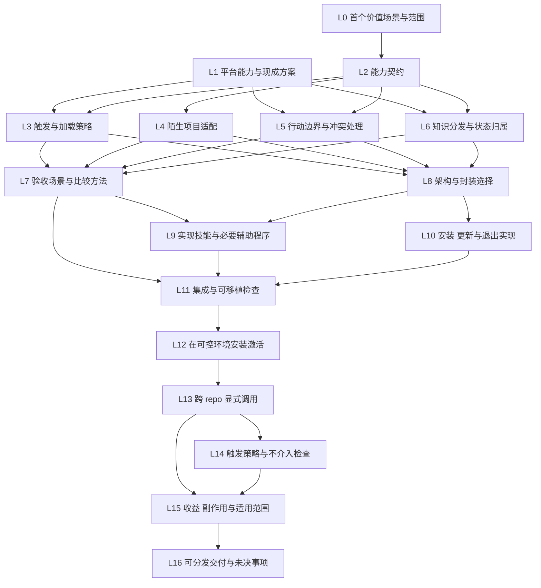

# Codex 跨项目能力实现计划

## 目标与完成定义

将本项目的方法转为可安装、可发现、可调用、可维护的 Codex 能力，使在另一个独立 repo 工作的新 session 能在需要时取得方法并执行合适行为，不依赖本对话或本机研究仓库路径。

交付物是可分发的技能或插件实现、必要的随包参考与辅助程序、安装维护方式、使用说明，以及跨 repo 行为的实际检查结果。具体封装由能力契约和平台能力共同决定；不是先把全部理论装进一个大 skill。

首个场景的推荐起点是“在陌生 repo 中接手并接续已有任务”：明确目标与边界、找到必要上下文、识别缺口、推进工作并留下可用成果。它针对本项目已经识别的跨会话与跨 repo 缺口。该推荐仍由 L0 形成明确范围，不自动包含整个 SDLC 的所有能力。

第二层完成需要同时满足：

- 能通过 Codex 支持的入口安装，且不要求在目标 repo 复制整套理论或使用 Ray 的绝对路径。
- 在独立 repo 的新 session 中，既能按约定显式调用，也能按选定触发策略介入；安装、发现、加载和执行分别检查。
- 缺失信息、项目约定冲突、不适用任务和权限不足时，有清楚的行为与停止边界。
- 留在目标项目中的内容有明确用途与维护归属；更新或卸载不破坏既有工作。
- 能说明相对于原有可用流程的收益和新增成本；触发不可靠或收益不足时明确限制，不仅以“安装成功”宣布完成。

本轮只制定计划，图中任务均未开始。用户级安装、长期跨项目行为改变和对外发布按具体授权处理，制定计划本身不执行这些动作。

## 依赖 DAG

L0 与 L1 为独立入口。箭头表示直接依赖；逻辑并行不构成启动多个 agent 的指令。理论建设成果是背景输入，不要求重新执行其全部任务。

## 任务定义

| ID | 状态 | 直接依赖 | 产出 | 完成条件 |
|---|---|---|---|---|
| L0 | 未开始 | 无 | 首个能力的使用者、触发情境、价值、范围与非目标 | 写出工具介入前后具体行为的差异；明确首场景和不做什么；以推荐判断推进，重要产品取舍需要 Ray 时带具体方案讨论 |
| L1 | 未开始 | 无 | 官方能力依据、现有工具与本机环境清单 | 核对用户级／项目级发现、显式和隐式调用、资源读取、插件分发、刷新生效及约束；查找可直接复用的方案；区分文档支持、现场可用和未知；不读取无关项目或回显凭据 |
| L2 | 未开始 | L0 | 与具体封装无关的能力契约 | 明确输入、前置条件、读取与动作、输出、副作用、完成／停止条件、缺信息时的行为；说明哪些任务直接推进、哪些只提出建议；每项行为能追溯到价值与理论依据 |
| L3 | 未开始 | L1、L2 | 触发、发现与渐进加载策略 | 区分安装、元数据可见、实际选择、正文和参考加载、执行；规定首版显式入口、适用触发和负例；若需持续行为，明确何种受支持入口承担，不能假定 skill 自动选择等于强制生效 |
| L4 | 未开始 | L2 | 陌生项目的发现与适配规则 | 说明如何确定目标 repo 与任务、查找当前约定和成果；处理无 AGENTS、无规格、无 Git、工作区有其他改动或资料矛盾；保留现有有效结构，不强制创建固定文档树或通读全仓库 |
| L5 | 未开始 | L1、L2 | 动作与权限矩阵、冲突和异常处理 | 区分读取、建议、写入、提交、安装配置与外部动作；理论方法不自动成为目标项目授权；尊重平台与目标项目约定；处理其他 skill 重叠、访问失败、取消和部分完成，不擅自扩大范围 |
| L6 | 未开始 | L1、L2 | 知识依赖清单与持久化约定 | 区分随包方法、按需参考、目标项目知识、现场状态与个人偏好；安装产物脱离本机研究 repo 仍可运行；必要参考有来源和更新方式；明确写入位置、维护责任及哪些过程不保存 |
| L7 | 未开始 | L3、L4、L5、L6 | 从规格推导的正反场景、结果判据与比较方法 | 覆盖显式调用、适用／不适用触发、陌生项目、缺信息、冲突、工作区保护和资源缺失；以行为与成本判断，不以文本相似度或 agent 自报成功打分；开发用例与后续未参与调规则的任务分开 |
| L8 | 未开始 | L3、L4、L5、L6 | 架构与封装决定、能力边界及文件组织 | 决定一个或多个 skill、是否需要 plugin、哪些动作仅用指令、哪些需脚本或其他机制；明确调用和资源关系；解释为何优于更简单方案，不默认加 hooks、MCP、数据库或后台服务 |
| L9 | 未开始 | L7、L8 | 可运行的技能、必要参考和辅助程序 | 按契约实现输入到输出的完整路径；触发描述和步骤清楚；必要资源随包可取得；确定性操作才使用代码；不将整套理论或会话塞进默认上下文；在本 repo 内可审查 |
| L10 | 未开始 | L8 | 安装、更新、禁用与卸载方式及说明 | 支持选定入口和可移植来源；处理同名内容、已有配置、重复安装、失败恢复和更新生效；不覆盖无关资产；退出后目标 repo 成果仍能独立理解；本任务先在隔离目录实现，不默认改真实用户配置 |
| L11 | 未开始 | L7、L9、L10 | 集成检查与可移植安装结果 | 在隔离环境检查可加载格式、依赖可达、安装与重装、升级和退出；确认不依赖作者绝对路径或源仓库；按 L7 检查必要行为及副作用；区分静态检查通过与真实 agent 行为成立 |
| L12 | 未开始 | L11 | 选定 Codex 环境中的安装与激活状态 | 先有可审查的产物、安装范围与配置差异；依实际授权执行，若未包含跨项目生效则请 Ray 决定；检查入口实际可见、所需刷新已完成；失败时说明阻塞，不用模拟结果代替 |
| L13 | 未开始 | L12 | 独立 repo 新 session 的显式调用记录与产出 | 不继承本对话；不把研究 repo 作为工作目录；使用实际安装入口；说明目标 repo、任务、可用配置和工具来源；先证明资源取得与能力执行，不靠手工补充本会话背景掩盖缺口 |
| L14 | 未开始 | L13 | 选定触发策略的正例、负例与限制 | 若承诺自动选择，检查应调用与不应调用的任务；若采用其他明确入口，检查其介入和退出行为；区分没有选择能力与执行失败，不能以显式调用成功代替触发可靠性 |
| L15 | 未开始 | L13、L14 | 收益、副作用、适用范围与剩余问题 | 与目标项目原有可用流程比较，观察重复解释、遗漏、返工及新增读取、记录和人的介入；检查成果污染与越界副作用；报告样本与条件，效果不足可收缩或修订范围，不无依据扩大功能 |
| L16 | 未开始 | L15 | 可分发产物、使用维护说明、适用限制与后续工作 | 新安装者可按说明取得并使用；说明已检查与未知范围；未通过项不写成完成；本地交付和外部发布分开，未经授权不创建公开发布或分发消息 |

## 关键分工与人的参与

agent 负责平台调研、现成方案比较、能力契约、架构选择、实现、检查和文档组织，不把例行技术决策交回给 Ray。

- L0 涉及重要价值或使用方式取舍时，请 Ray 参与；提供推荐场景、具体行为与代价，不只罗列选项。
- L5 对跨项目长期行为和权限的选择，使用已有明确授权；新边界需要 Ray 决定。
- L12 的真实安装如果超出已有授权，先完成实现和可审查安装方案，再请求决定。隔离环境准备工作不因此停下。
- L13—L15 如需独立 session 或真实工作机会，明确所需任务和环境；只暂停依赖它的部分。不得把同一 session 的自检称为独立接续。

## 产物与状态的维护

本文件是第二层任务的唯一状态入口。[理论计划](plan.md)保留第一层的完成范围，不将两个阶段的“完成”混用。

执行时逐步形成能力契约、架构决定、实现及检查材料；可以合并在少量用途明确的文件中，不为每个节点预建报告、目录或占位文件。可安装能力的事实以实际实现为准，尚未实现的方案保留提议身份。

对目标 repo 的写入应可归因于当前任务。产品不默认复制 Ray 的个人偏好或本研究项目专用授权；理论来源、通用方法与用户个人信息分开维护。

修订会影响依赖时，更新相关契约、场景和 DAG；保留已通过结果的适用范围。当前 DAG 表达依赖，不声称无须迭代，也不在缺乏时长估计时伪造关键路径。

## 下一步与退出条件

下一步先推进 L0 和 L1，再形成 L2；未确定首场景和能力契约前，不开始写技能正文或选择插件结构。

若现有能力已经满足需求，应优先复用并交付必要适配；若平台无法支持预期触发或资源读取，应回到相应契约调整范围，而非让用户每次手动粘贴整套背景却仍宣称已实现跨项目能力。

有限范围内的工作流可以先交付，但需要明确哪些理论已转成行为、哪些仍只是参考材料。首场景成立不代表整套理论都已产品化。
