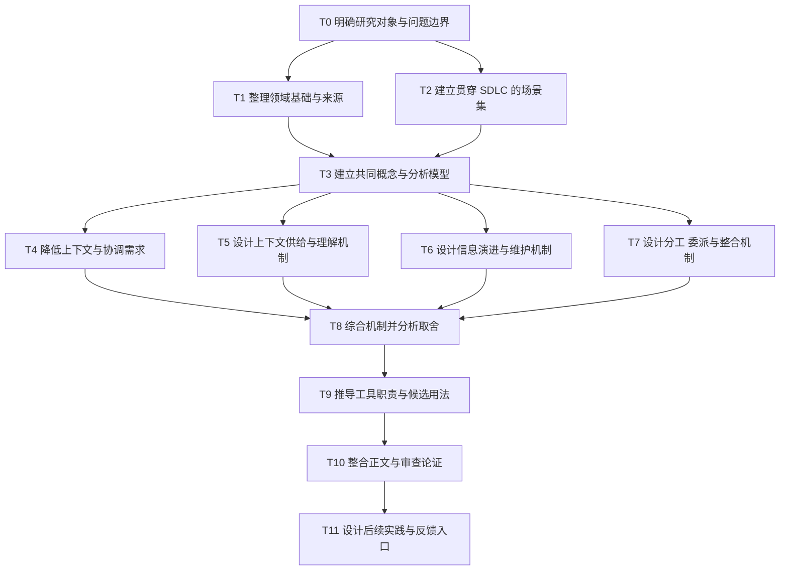

# 理论建设计划与任务 DAG

## 目标与交付边界

构建有明确领域基础、概念、机制、推论与适用边界的设计框架，用于推导人类与 agent 协作的 SDLC 信息组织和工具用法。

交付包括：理论正文、信息目录、来源与命题的对应关系，以及尚未解决的问题。现有文档是输入材料，其内容需要重新审视，不能作为必须保留的正确答案。

任务进展以任务表中的状态与成果入口为准。理论建设不预设需要新记忆系统、skill 或平台，也不将经验验证作为所有推导的前置条件。实施与试用在理论成果形成后另行选择。

## 任务依赖

箭头表示下游需要上游的可用产出，不只是推荐阅读顺序。图中分支表示逻辑上可并行，不构成启动多个 agent 的指令。

## 任务定义

只有直接依赖具备可用产出，才推进下游；不要求上游问题全部获得最终答案，但必须明确未决问题及其对下游的限制。

| ID | 状态 | 直接依赖 | 工作与产出 | 完成条件 |
|---|---|---|---|---|
| T0 | 完成 | 无 | 明确分析单位、目标、核心问题、假设与非目标；写入理论入口 | 区分设计问题、经验问题与实现问题；明确研究人、agent、工具和任务组成的协作系统；目标不被 Git 或 meta 污染这一症状限定 |
| T1 | 完成 | T0 | 整理分布式认知、共同基础、协调理论、软件模块化与配置管理、信息行为与决策、来源追踪的直接相关结论 | 每项采用的理论有一手来源、原适用范围、对本项目的用处与迁移限制；区分已有结果、我们的推论与假设；不为凑领域数量扩充综述 |
| T2 | 完成 | T0 | 建立覆盖需求、设计、实现、发布、运行和退役的少量贯穿场景 | 包含明确任务、开放探索、交接、条件变化与并行依赖；包含至少一个无需新增记录机制的简单场景；虚构案例明确是假设 |
| T3 | 完成 | T1、T2 | 定义参与者、任务、契约、资产、认识、承诺、事件与载体及其关系，明确状态和分析层级 | 代表场景可用同一模型描述；避免混用对象、陈述、载体和状态；MECE 用于同维度职责检查，不强称自然语言类别绝对互斥 |
| T4 | 完成 | T3 | 推导如何通过任务划分、模块化、信息隐藏、契约和责任边界降低信息与协调需求 | 给出哪些信息可以不共享、哪些仍必须共享的理由；说明局部封装与跨模块影响的边界；不能把增加上下文作为默认解法 |
| T5 | 完成 | T3 | 推导默认提供、任务组装、按需查询、现场获取、与人协商及理解校准的组合 | 说明入口、展开规则、来源冲突、未知缺口与停止条件；区分信息取得与共同理解；不假设 agent 具有与人相同的认知机制 |
| T6 | 完成 | T3 | 推导信息产生、采用、提炼、关联、更新、替代、归档与遗忘的机制 | 区分事实、决定、授权、实现与生效；说明维护责任、变化触发与提炼损失；区分当前视图和历史；不要求一切信息走同一流水线 |
| T7 | 完成 | T3 | 推导人和 agent 的分工、委派、共享依赖、交接与整合 | 分别处理内容、语义、状态、承诺和资源冲突；区分能力、信息、权限与责任；明确何时需要人参与，避免把人变成逐步审批者 |
| T8 | 完成 | T4、T5、T6、T7 | 将需求降低、上下文供给、信息演进与协作整合，形成条件性的设计原则与取舍 | 同一场景中各机制能共同工作；纳入获取、维护、协调、错误和人的注意力成本；说明何时不值得增加机制；关键主张有依据与反例边界 |
| T9 | 可开始 | T8 | 推导 Git、文档、会话、任务系统、运行系统、索引与流程能力的职责及可替代方案 | 工具用法能追溯到具体需要；区分原有能力、新用法和需要新增的能力；不给每个信息类别强配一个文件或工具 |
| T10 | 未开始 | T9 | 整合理论正文、信息目录和案例，整理来源与命题的对应关系，清理重复与过早结论 | 目标—基本问题—模型—机制—推论—工具职责的论证可贯通；明确开放问题；将本项目工作约定与可推广结论区分；不声称理论已获经验支持 |
| T11 | 未开始 | T10 | 列出值得优先获得反馈的主张，设计最小实践任务与新会话接续方式 | 说明实践能回答什么、不能回答什么；区分本 session、仓库、平台配置和模型能力的影响；只形成后续任务，不默认启动实施或实验 |

## 成果入口

- T0、T3：[理论正文](theory.md)中的研究边界、共同对象、关系与状态。
- T1：[领域基础与命题依据](foundations.md)。
- T2：[贯穿场景](examples/scenarios.md)。
- T4—T8：[理论正文](theory.md)中的需求降低、上下文、信息演进、协作、机制合流与 P1—P7。

## 产物组织

- `theory.md` 承载模型、机制、条件性推论和适用边界。
- `information-model.md` 承载信息目录及职责，引用理论，避免重复维护论证。
- `examples/` 按需要承载贯穿场景；能复用一个场景时不为每项任务新建文件。
- 来源与命题的对应关系优先放在理论正文附近；篇幅影响阅读后再拆分参考材料。
- `inquiry.md` 只保留尚需选择、解释或推进的问题。
- `workflow.md` 和 `AGENTS.md` 表达本项目的实际约定；理论产出不自动改变授权。
- 本文件维护任务状态与依赖，不兼任执行日志；完成任务后保留成果入口，变化过程由 Git 保存。

任务与文件不是一一对应关系。暂不创建每项任务的占位文件、独立报告或总结。

## 执行安排与人的参与

T0、T3 的成果见理论正文的“研究对象与边界”和“基本对象、关系与状态”；T1 见 [命题依据](foundations.md)，T2 见 [贯穿场景](examples/scenarios.md)。T1 与 T2 在 T0 后可独立推进；T4—T7 在 T3 后可分别研究，合流时由 T8 处理相互制约。

任务粒度暂不附带工期和关键路径估算：在没有可信时长估计前，只表达依赖和合流点。需要修订上游时更新受影响任务与依赖，保持 DAG 无环，不用回边伪装迭代。

agent 主导领域梳理、机制设计、资料核对、文档组织与本地提交。出现影响研究目标、预期使用者或重要产品取舍的议题时，向 Ray 提供推荐、理由与影响；仅暂停依赖该判断的任务。

理论形成后的工具建设、真实软件项目试用及对外动作，按其具体范围另行确定。后续任务计划不等于对外行动授权。
